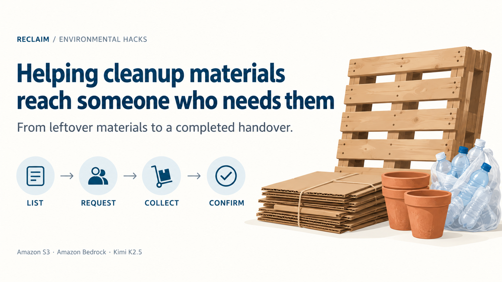
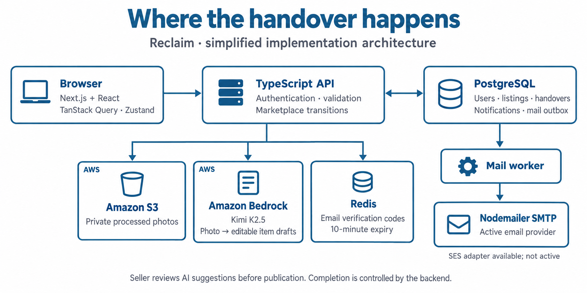
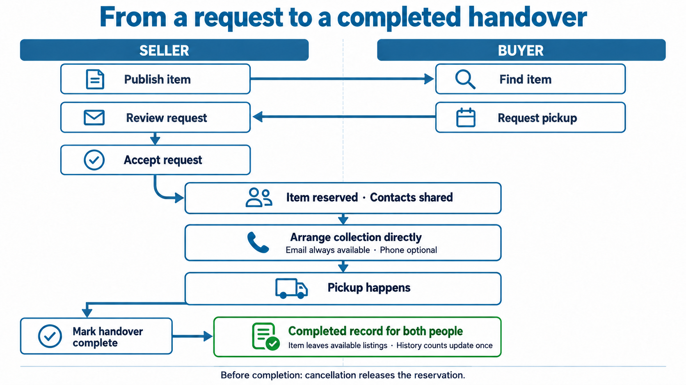

# Reclaim: Helping cleanup materials reach someone who needs them

I saw students cleaning up after a protest, taking responsibility for the space they had used. It made me think about what happens to the materials after a cleanup.

Some of those materials could be used again. Someone might need leftover wood for a project, cardboard for packaging, or pots for a garden. But the person holding the materials may have no way to find that person. The person who needs them may never know they are available.

That connection is difficult to make. An organiser has to find interested people, explain what is available, answer questions and arrange collection. Even when an item is offered for free, someone still needs to discover it and pick it up.

I wanted to make that process easier. During Environmental Hacks, I built Reclaim so people could offer materials from events and cleanups, find items they need, and arrange a handover.

## How Reclaim works

Anyone can offer or collect materials using the same account. A seller can list an item for a price or give it away, depending on its value and condition.

They add photos, describe the material, enter its quantity and provide pickup information. Buyers can browse listings and view item details without signing in. An account is required when they want to send a request.

The flow continues through collection:

1. The buyer finds an item and proposes a pickup time.
2. The seller reviews the request and accepts or declines it.
3. After acceptance, both people can access each other's contact details.
4. They arrange pickup directly.
5. After collection, the seller marks the handover complete.

Both people keep a record of the completed exchange. Their profiles show how many handovers they have completed, giving future buyers and sellers some history to review. That history provides context; it cannot guarantee how the next exchange will go.

## The architecture follows the handover

_Simplified implementation architecture. S3 and Bedrock are AWS services. The active mail provider is Nodemailer SMTP; SES is an available adapter. This diagram describes responsibilities, not a claim that every component is deployed on AWS._

Reclaim has a marketplace workflow and an optional photo-analysis step.

The marketplace controls publication, requests, acceptance and completion. Photo analysis helps the seller prepare a listing. It cannot publish an item or accept a request.

| Responsibility                                      | Implementation                            |
| --------------------------------------------------- | ----------------------------------------- |
| Listings, discovery, profiles and handover screens  | Next.js and React                         |
| API fetching and cached data                        | TanStack Query                            |
| Client state                                        | Zustand                                   |
| Authentication, validation and marketplace rules    | TypeScript backend                        |
| Users, items, requests, handovers and notifications | PostgreSQL                                |
| Listing photos                                      | Amazon S3                                 |
| Suggestions from photos                             | Kimi K2.5 on Amazon Bedrock               |
| Temporary email-verification codes                  | Redis                                     |
| Email delivery                                      | Transactional outbox with Nodemailer SMTP |

PostgreSQL stores the relationship between an item and its requests. Acceptance and completion update the relevant records within a transaction, so the listing and handover stay consistent.

The backend validates and processes uploaded photos before storing them in a private S3 bucket. PostgreSQL stores the upload's ownership and object key; the image bytes stay in S3.

When the seller requests photo suggestions, the backend retrieves the image, calls Kimi through Amazon Bedrock and validates the response before returning editable fields.

Notifications are recorded alongside marketplace changes. An outbox worker handles email delivery afterward. The current configuration uses Nodemailer SMTP, with an SES adapter available for a later switch.

## Helping sellers describe what they have

A seller may have several materials to list and little time to describe each one. Reclaim lets them start with a photo.

After uploading it, they select **Find items in photo**. The backend makes one request to the serverless `moonshotai.kimi-k2.5` model on Amazon Bedrock.

The prompt asks the model to identify visible reusable or recyclable materials and return English names, descriptions, condition notes and possible hazards in structured JSON. The backend checks the response before converting it into item drafts.

The seller reviews those drafts, corrects the details and enters a price. They still publish through the normal listing form.

A photo cannot tell us everything about a batch. It cannot establish weight, reveal hidden damage or confirm that an item is safe. The model is instructed to avoid inventing those details and to report uncertainty.

Suggestions also preserve items the seller has already entered manually. If analysis fails after a successful upload, **Keep photo and enter details** lets them continue with the uploaded image. They can finish describing their materials without making another model call.

## Connecting the buyer and seller

_Acceptance reserves the item. Seller-confirmed completion removes it from available listings and contributes to both participants' completed history._

The buyer proposes a future pickup time and can add a note about transport, intended use or a question for the seller.

While the request is pending, the item remains available. Other interested buyers can request it too. The seller can review each proposal and open the buyer's public profile before responding.

Acceptance reserves the item for the selected buyer and declines competing pending requests. The backend locks the relevant records and applies this change transactionally, preventing two requests from reserving the same item.

Once accepted, both participants can see each other's account email and optional mobile number. A phone number is not required: email gives them a way to connect.

These details are kept off public listings. Contact access belongs to the handover participants, and email-verification status is shown separately.

Both people receive in-app notifications. Handover emails go to verified addresses.

They arrange collection and any payment directly. Reclaim records the asking price but does not process money or verify payment.

## Recording that collection happened

An accepted request means the participants have agreed. Collection may still be ahead of them.

After pickup, the seller selects **Mark handover complete**. The backend completes the handover and marks the item as done in the same transaction. It then leaves discovery and the seller's active listings.

Both participants retain the record. It contributes one completed offered handover to the seller's history and one completed collected handover to the buyer's history.

Listings and accepted requests do not increase those counts. Repeated taps or retried completion requests must not add another exchange.

Before completion, either participant can cancel an accepted handover. Cancellation releases the reservation, makes the item available again and leaves the completed counts unchanged.

## What changed during the build

Several decisions became clearer as I worked through the collection process.

One was the event date. An early version linked collection to a listing window. But materials from an older event may still be useful, and a seller should be able to offer them later.

I separated the dates. The event or cleanup date gives buyers context about where the material came from. The buyer proposes a pickup time for the new exchange. An old event date does not prevent publication, requests or completion.

I also changed email verification. People can create an account and start using Reclaim immediately, then verify their email from Profile. Redis stores a hash of the six-digit verification code with a ten-minute expiry.

The verification status remains visible to other participants. Unverified accounts can still list materials, send requests and complete handovers.

Photo analysis exposed a configuration issue during testing. AWS returned `BEDROCK_ACCESS_DENIED` even though the application's environment file contained a Bedrock key.

The backend was selecting an inherited `AWS_BEARER_TOKEN_BEDROCK` value before Reclaim's configured `AWS_BEDROCK_API_KEY`. The two keys were different.

I changed the priority to prefer Reclaim's configured key and added regression coverage for that choice and the fallback alias. A small live Kimi text request then returned HTTP 200 with the expected response.

That confirmed access with the selected key. Photo upload, image recognition and editable suggestions need their own checks; a successful text request does not verify that whole path.

## What I have tested

I have tested the main application flows, including account creation, publication, requests, acceptance and completion.

Automated tests also cover competing acceptance requests, repeated completion, token refresh, private contact access, optional verification and recovery after a simulated AI failure.

The reviewed checkout passed 25 backend tests, 16 frontend tests and 12 browser tests across desktop and mobile. Lint, type checks and builds passed too. After correcting the Bedrock key priority, the backend tests and build passed again.

The next step is to test Reclaim with a real cleanup batch and real collectors. I want to see whether organisers can list what they have, whether interested people can find it, and whether both sides can finish collection without help from the team.

The idea started with materials that could still be useful but might never reach the person who needed them. Reclaim gives those people a place to find each other and a process for completing the exchange.

## Publication notes

Remove this section before publishing. Add the public repository URL, the public or unlisted YouTube demo link, contributor names and their actual contributions, and the AI tools used for implementation and writing. Do not invent missing links or credits. Upload the three PNG files into Builder Center where their Markdown references appear. The graphics are conceptual explanations generated with the built-in imagegen tool, not screenshots or evidence of a live deployment.

Use real, redacted screenshots beside the photo-analysis and handover sections after confirming those flows in the running application. Keep image-source credits from [the testing guide](./test.md) if those sample photos appear in shared screenshots.
